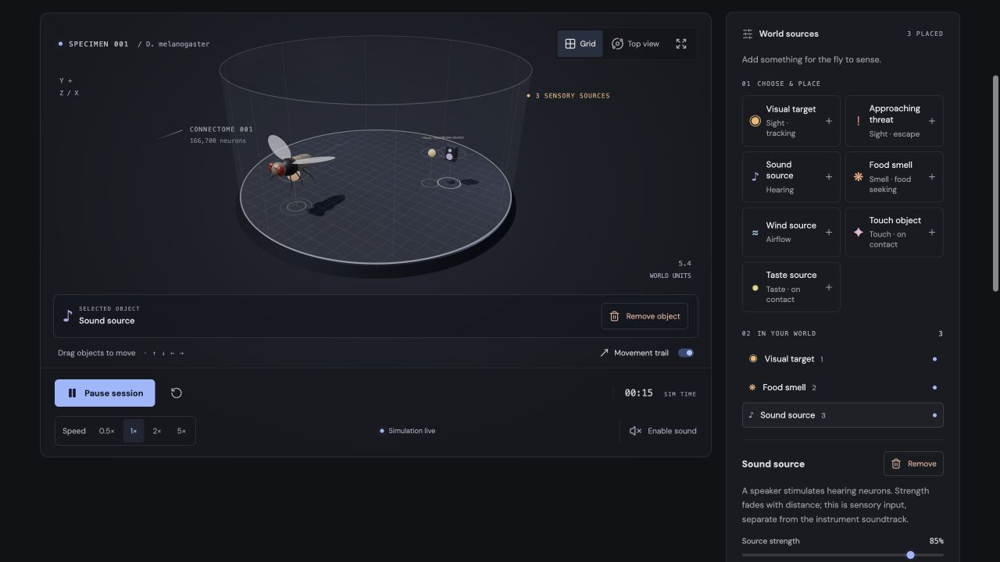
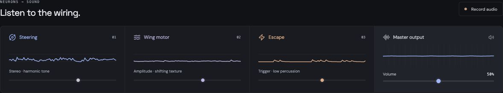
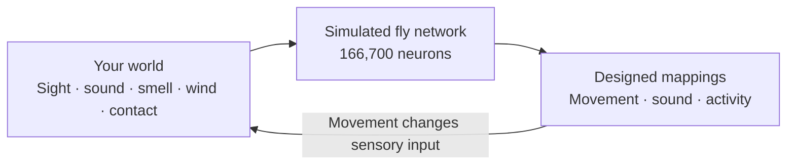

# What does a fly’s brain sound like?

**Fly Brain Simulator** turns a mapped fly brain into an instrument. Build its world, watch it react, and hear neural activity become sound.

[](MODEL.md)
[](MODEL.md)
[](docs/README.md#play)
[](#try-it)



## Change the world. Hear what happens.

- **Give it something to sense.** Place light targets, threats, sound, food smells, wind, touch or taste sources.
- **Watch the response.** Move objects, follow live neural activity, and slow down or speed up time.
- **Make a little noise.** Mix steering, wing and escape signals into sound. Record audio or export activity as JSON.



## Try it

With Node.js **22.12+** or a supported newer version:

```sh
git clone https://github.com/ottobonilla95/fly-brain-simulator.git
cd fly-brain-simulator
npm install
npm run dev
```

Open the local URL, press **Start instrument**, then choose a source and click the chamber. Headphones recommended. The bundled brain loads about **58 MB**; everything runs locally, with no account or API key.

## From world to sound



Measured wiring, simplified neurons, designed movement and music. Food seeking uses an added decoder. [See exactly what is simulated →](MODEL.md)

**Keep exploring:** [Controls & setup](docs/README.md) · [Model & limits](MODEL.md) · [Verification](docs/README.md#verification)

Built on [alextitonis/fly.ai](https://github.com/alextitonis/fly.ai). [Upstream MIT license](licenses/fly-ai-MIT.txt).
